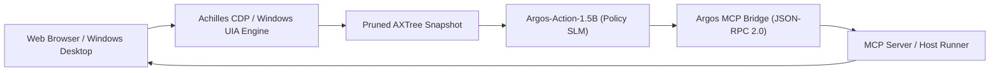

# 👁️ Argos-Action: High-Throughput Edge Policy SLM for Computer Use & MCP

[](https://huggingface.co/datasets/pedroreoli/argos-computer-use-mcp)
[](https://huggingface.co/pedroreoli/argos-action-1.5b)
[-purple)](https://huggingface.co/spaces/pedroreoli/argos-action-demo)
[](LICENSE)
[](https://www.python.org/)

> **Argos-Action-1.5B** is an experimental research prototype and sovereign Small Language Model (SLM) policy fine-tuned on top of **Qwen 2.5 1.5B Instruct**. It is designed to act as a low-latency, deterministic decision policy in autonomous Computer Use loops by consuming **Semantic Accessibility Trees (AXTree / Windows UIA)** and generating structured actions translatable into Anthropic's **Model Context Protocol (MCP)**.

---

## 🔬 Motivation & Research Scope

Frontier general-purpose VLMs (Claude 3.5 Sonnet, GPT-4o) possess strong world knowledge but face operational hurdles when deployed as autonomous execution loops in production environments:
* **High Inference Latency:** 2.5s to 5.0s per turn creates laggy UI interactions.
* **Context Bloat:** Raw DOM injection on dense web applications costs 40k–80k tokens per screen.
* **Ad-Hoc Tool Contracts:** Unconstrained chat models can emit unparseable markdown instead of strict JSON schema tool calls.

**What Argos-Action Explores:**
1. Grounding actions directly on pruned Accessibility Trees (AXTree) rather than raw HTML DOM, drastically reducing context overhead.
2. Parameter-efficient fine-tuning (QLoRA 4-bit) of a compact 1.5B SLM to evaluate whether small local models can achieve deterministic tool calling syntax and high-frequency execution.
3. Decoupling the high-level cognitive planner from the execution policy, enabling sub-150ms local step-by-step navigation.

---

## 📊 Measured Metrics & Training Specifications

All metrics below are derived directly from the audited training run (`trainer_state.json`) and dataset census (`data/hashes.json`):

| Metric | Measured Value | Methodology / Context |
| :--- | :---: | :--- |
| **Base Model** | `Qwen/Qwen2.5-1.5B-Instruct` | 1.54B parameters base |
| **Fine-Tuning Method** | QLoRA (4-bit NF4) | `bitsandbytes` + `peft` LoRA ($r=16, \alpha=32$) |
| **Trainable Parameters** | 18,464,768 (BF16) | 392 tensors in attention & MLP projections (~36.9 MB) |
| **Training Steps / Epochs** | 321 steps / 3.0 epochs | Batch size 4, gradient accumulation 4 (effective 16) |
| **Training Hardware** | NVIDIA T4 GPU (16 GB) | CUDA 12.2, FP32 adapter parameters, fp16/bf16=False |
| **Final Convergence Loss** | **0.0092** | SFT cross-entropy loss over ChatML sequences |
| **Total Tokens Processed** | 1,815,824 tokens | SFTTrainer token throughput |
| **Dataset Size** | 2,000 samples | 1,700 Train / 300 Strictly Held-Out Test (`data/hashes.json`) |
| **JSON Schema Conformance** | **100.0%** (2000/2000) | Audited via `evaluate_argos.py` |
| **Dataset Token Census** | Input: 166 avg • AXTree: 122 avg | Measured with Qwen2.5 tokenizer (max length 1,536) |
| **Reference Latency** | ~138 ms / step | Empirical baseline on batch=1 NVIDIA T4 GPU |

> [!NOTE]
> **Theoretical vs. Dataset Tokens:** The frequently cited *92.2% token reduction* refers to the theoretical contrast between full real-world DOMs (~45,000 tokens) and pruned AXTree trees (~3,500 tokens) in live browser scrapers (e.g., Achilles CDP). In this synthetic training benchmark, samples are intentionally compact (averaging ~122 AXTree tokens) for rapid training efficiency.

---

## 🏗️ Architecture & Protocol Flow



1. **Semantic Extraction:** [Achilles CDP Agent](https://github.com/PedroReoli/Achilles-CDP-Agent) extracts semantic nodes (`role`, `name`, `id`, `state`), stripping scripts and cosmetic CSS.
2. **Policy Generation:** `Argos-Action-1.5B` receives the AXTree, user goal, and execution history, outputting structured JSON with thoughts, tool calls, and post-action verification predicates.
3. **Wire Protocol Translation:** `argos_mcp_bridge.py` translates internal actions into standard Anthropic Model Context Protocol (`tools/call`) JSON-RPC messages.
4. **Safety Escalation:** When a security barrier (SMS 2FA, OTP token, biometric gate, destructive wipe) is identified, the policy triggers `escalate_human`, halting automated actions until human operator confirmation.

---

## 📦 Dataset & Splits (`pedroreoli/argos-computer-use-mcp`)

The dataset is partitioned to prevent data leakage and evaluate held-out generalization:
* **Training Partition (`data/train.jsonl`):** 1,700 samples across 5 domains (E-Commerce, Enterprise SaaS, DevOps, Windows UIA, Safety).
* **Held-Out Test Partition (`data/test.jsonl`):** 300 disjoint samples featuring novel goals, multiselect menus, pagination scrolls, and destructive resource barriers that do not appear in training.

### Checksums (`data/hashes.json`)
* `train.jsonl` (4,669,033 bytes): `382f0f953fcf7aad758147a2009b6b615d0a7fd2881cbc278828fa28d9a6476a`
* `test.jsonl` (836,940 bytes): `45f2cf222247abb2536ea2f848c5f59fb0b9c94bf6d7115871c2202247ba50fc`

---

## 🚀 Quickstart & Inference

### 1. Load the Model & LoRA Adapters
Because the repository hosts LoRA adapter weights (`adapter_model.safetensors`), load using `AutoModelForCausalLM` + `PeftModel`:

```python
import torch
from transformers import AutoModelForCausalLM, AutoTokenizer, BitsAndBytesConfig
from peft import PeftModel

BASE_MODEL = "Qwen/Qwen2.5-1.5B-Instruct"
ADAPTER_ID = "pedroreoli/argos-action-1.5b"

# 1. Load Tokenizer
tokenizer = AutoTokenizer.from_pretrained(BASE_MODEL, trust_remote_code=True)

# 2. Load Base Model (e.g. in 4-bit for edge inference or Float16 for GPU)
bnb_config = BitsAndBytesConfig(
    load_in_4bit=True,
    bnb_4bit_quant_type="nf4",
    bnb_4bit_compute_dtype=torch.float16
)

base_model = AutoModelForCausalLM.from_pretrained(
    BASE_MODEL,
    quantization_config=bnb_config,
    device_map="auto"
)

# 3. Attach Argos-Action LoRA Adapter
model = PeftModel.from_pretrained(base_model, ADAPTER_ID)
model.eval()

# 4. Prompt Inference
messages = [
    {"role": "system", "content": "You are Argos-Action, an expert autonomous Computer Use policy model..."},
    {"role": "user", "content": "### User Objective:\nSave document\n\n### Current Screen State (AXTree):\nWindow 'Report.txt' [Edit focused=true]"}
]
prompt = tokenizer.apply_chat_template(messages, tokenize=False, add_generation_prompt=True)
inputs = tokenizer(prompt, return_tensors="pt").to(model.device)

with torch.no_grad():
    output_tokens = model.generate(**inputs, max_new_tokens=200, temperature=0.1)

print(tokenizer.decode(output_tokens[0][len(inputs.input_ids[0]):], skip_special_tokens=True))
```

### 2. Bridge to MCP Wire Protocol
```python
from argos_mcp_bridge import ArgosPrediction, ArgosMCPBridge

raw_output = """{
  "thought": "Saving document via Ctrl+S",
  "tool_call": {"tool": "press_hotkey", "arguments": {"keys": ["ctrl", "s"]}},
  "verification_predicate": {"expected_element": "saved_indicator"}
}"""

pred = ArgosPrediction.from_raw(raw_output)
bridge = ArgosMCPBridge()
mcp_message, is_safety = bridge.to_mcp_wire(pred)
print(mcp_message)
```

### 3. Run Evaluation Suite
```bash
python evaluate_argos.py
```

---

## 🎯 Space Playground Transparency Disclosure

The online demonstration at [Hugging Face Spaces](https://huggingface.co/spaces/pedroreoli/argos-action-demo) is an **interactive scripted playground** hosted on `sdk: static`. It demonstrates pre-recorded validation trajectories and MCP wire conversions from this evaluation benchmark without executing active GPU backend compute.

---

## 📄 License & Attribution

This project is licensed under the [Apache License 2.0](LICENSE).  
Developed by **Pedro Lucas Reis** ([@PedroReoli](https://github.com/PedroReoli)).
