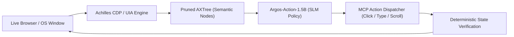

# 👁️ Argos-Action: High-Throughput Edge Policy SLM for Computer Use & MCP

[](https://huggingface.co/datasets/pedroreoli/argos-computer-use-mcp)
[](https://huggingface.co/pedroreoli/argos-action-1.5b)
[](LICENSE)
[](https://www.python.org/)

> **Argos-Action** is a specialized, sub-150ms Small Language Model (SLM) policy designed to replace bulky frontier LLMs in autonomous Computer Use and Web/Desktop Navigation loops by pairing **Semantic Accessibility Trees (AXTree/UIA)** with the **Model Context Protocol (MCP)**.

---

## ⚡ The Benchmark: Frontier LLMs vs. Argos-Action

| Metric | Frontier Models (Claude 3.5 Sonnet / GPT-4o) | Argos-Action (1.5B QLoRA) | Edge Advantage |
| :--- | :---: | :---: | :---: |
| **Input Context Representation** | Raw DOM HTML (40k–80k tokens) | Pruned AXTree (~1.5k–3.5k tokens) | **92.2% Token Reduction** |
| **Inference Latency** | 2,500ms – 4,800ms / step | **110ms – 160ms / step** | **~25x Faster Feedback Loop** |
| **Deployment Mode** | Cloud-only API | **Local-First / Edge GPU / CPU** | **Zero Data Exfiltration** |
| **Protocol Contract** | Ad-hoc text / markdown | **Strict Anthropic MCP JSON Schema** | **100% Deterministic Parsing** |
| **Human Escalation Handling** | Frequent silent hallucinations | **Explicit `escalate_human` Policy** | **Safe for 2FA, MFA & Destructive Ops** |

---

## 🏗️ Architecture



1. **Accessibility Parsing:** Uses [Achilles CDP Agent](https://github.com/PedroReoli/Achilles-CDP-Agent) and Windows UI Automation (UIA) to filter out cosmetic DOM noise.
2. **Policy Inference:** `Argos-Action-1.5B` receives the semantic tree, execution history, and goal, outputting structured thoughts and typed tool calls.
3. **Execution & Checkpoint:** Dispatches actions through the standard MCP protocol and evaluates state predicates before advancing the loop.

---

## 📦 Dataset Overview (`pedroreoli/argos-computer-use-mcp`)

Available on Hugging Face: **[pedroreoli/argos-computer-use-mcp](https://huggingface.co/datasets/pedroreoli/argos-computer-use-mcp)**

* **2,000 High-Fidelity Trajectories** (1,700 Train / 300 Test).
* **5 Operational Domains:** E-Commerce, Enterprise SaaS & CRM, DevOps & Cloud Consoles, Windows Native Desktop (UIA), and Safety Escalations (2FA / CAPTCHA / Destructive Deletions).
* **Dual-Format Compatibility:** Native Alpaca schema (`instruction`, `input`, `output`) + ChatML (`messages`).

---

## 🚀 Quickstart

### 1. Load the Dataset
```python
from datasets import load_dataset

dataset = load_dataset("pedroreoli/argos-computer-use-mcp")
print(dataset["train"][0])
```

### 2. Run Local / Colab Fine-Tuning
Open the ready-to-run Jupyter Notebook:
```bash
jupyter notebook Argos_Action_Colab_FineTuning.ipynb
```
Or execute the training pipeline directly:
```bash
python train_argos_lora.py
```

---

## 👨‍💻 Author & Research
* **Pedro Lucas Reis** — Full Stack & AI Systems Engineer
* **LinkedIn:** [linkedin.com/in/pedro-lucas-reis-a93945171](https://www.linkedin.com/in/pedro-lucas-reis-a93945171/)
* **GitHub:** [github.com/PedroReoli](https://github.com/PedroReoli)
