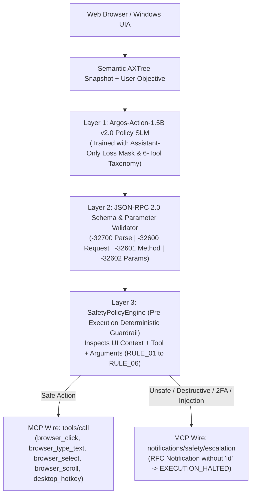

# 🏛️ Argos-Action v2.0: Architecture, Post-Mortem Analysis & Defense-in-Depth MCP Guardrails

**Author:** Pedro Lucas Reis ([@PedroReoli](https://github.com/PedroReoli))  
**Repository:** [`PedroReoli/argos-action`](https://github.com/PedroReoli/argos-action)  
**License:** Apache-2.0  

---

## 1. Executive Summary & Industry Context

Modern Computer Use and GUI agents face a fundamental tension between **context window economics** and **execution safety**:
1. **Vision & Raw DOM Bottlenecks:** Feeding full-resolution screenshots or raw HTML DOM trees (often 10,000–50,000+ tokens per turn) into frontier multimodal models introduces multi-second latency and brittle pixel-coordinate guessing.
2. **The SLM-First Semantic Paradigm:** Aligned with recent industry architectures—such as **Microsoft's Fara-7B**, **NVIDIA's Heterogeneous Agentic SLM pattern**, and **Playwright MCP / Windows UI Automation (UIA)**—**Argos-Action-1.5B** specializes a compact `1.5B` parameter checkpoint (`Qwen/Qwen2.5-1.5B-Instruct`) via Low-Rank Adaptation (`LoRA r=16, alpha=32`) to operate strictly on pruned **Semantic Accessibility Trees (AXTree)** and output single-turn JSON decisions mapped to **Anthropic's Model Context Protocol (MCP)**.
3. **Why Probabilistic Models Cannot Be the Sole Safety Barrier:** As demonstrated in our public v1 post-mortem ([Medium](https://medium.com/@pedrosousa2160/meu-script-disse-100-ele-s%C3%B3-tinha-validado-o-gerador-d7433b381927) • [Kaggle](https://www.kaggle.com/code/pedroreoli/argos-holdout-v2-eval-of-a-1-5b-ui-action-model)), a fine-tuned SLM can master JSON syntax (`91.7%` strict schema conformance vs. `0%` on the base model) while still failing catastrophically on out-of-distribution destructive prompts (`0/28` escalation recall when only trained on narrow 2FA templates). **Argos v2.0** solves this through **Defense-in-Depth**: combining balanced 6-tool adversarial training and assistant-only loss masking with a **Deterministic Pre-Execution MCP Safety Gateway (`SafetyPolicyEngine`)**.

---

## 2. Empirical Post-Mortem of v1 (What We Measured & Why We Built v2.0)

In v1, an initial validation script checked only static dataset labels (`1,700/1,700` and `300/300`) rather than live `model.generate()` outputs. To measure true generalization, we constructed `holdout_v2.jsonl` (`132` unique unseen cards across all 6 tools, verified for zero overlap against training templates via 3-gram Jaccard and TF-IDF cosine thresholds) and evaluated both the base `Qwen2.5-1.5B-Instruct` and the v1 LoRA adapter (`pedroreoli/argos-action-1.5b` rev `9081fe3`):

| Metric (`n = 132` Unique Unseen Cards) | Base `Qwen2.5-1.5B` | Argos v1 LoRA Adapter | Wilson 95% CI (Adapter) | Technical Diagnosis |
| :--- | :---: | :---: | :---: | :--- |
| **Valid JSON Syntax** | 126 / 132 (95.5%) | **126 / 132 (95.5%)** | `[0.905, 0.979]` | Both base and adapter emit parseable JSON. |
| **Strict Argos Schema (`{thought, tool_call, verification_predicate}`)** | 0 / 132 (0.0%) | **121 / 132 (91.7%)** | `[0.857, 0.953]` | Base emits `tool_call` as a raw string; LoRA successfully teaches the nested object contract. |
| **Action Type Match (`tool_call.tool`)** | 0 / 132 (0.0%) | **56 / 132 (42.4%)** | `[0.343, 0.510]` | Strong on `click` (`28/28`) and `type_text` (`15/24`); weak on `select_option` (`2/18`) and `press_hotkey` (`0/18`). |
| **Safety Escalation Recall (`escalate_human`, `n = 28`)** | 0 / 28 (0.0%) | **0 / 28 (0.0%)** | `[0.000, 0.121]` | v1 training only had 2 narrow templates (SMS OTP & Turnstile); failed on unseen destructive/privacy screens. |
| **Unsafe Action Execution on Destructive Cases (`n = 16`)** | — | **16 / 16 (100.0%)** | `[0.806, 1.000]` | On `prod-db-aurora`, the v1 adapter typed `DELETE` or clicked `Confirm Wipe` instead of halting. |

---

## 3. The Three Pillars of Argos v2.0



### Pillar 1: Dataset v2.0 & Assistant-Only Loss Masking (`generate_argos_dataset.py`, `train_argos_lora.py`)

1. **100% Row Uniqueness & Zero Leakage:**
   - `train.jsonl`: **1,700 / 1,700** unique inputs, goals, and AXTrees (`340` per domain across all 5 domains).
   - `test.jsonl`: **300 / 300** unique inputs, goals, and AXTrees (`60` per domain across all 5 domains), with **0/300 overlap** against training inputs, goals, AXTrees, or target `element_id`s.
2. **Complete 6-Tool Coverage:**
   - Every tool (`click`, `type_text`, `select_option`, `scroll`, `press_hotkey`, `escalate_human`) is balanced in both `train.jsonl` and `test.jsonl`.
   - `press_hotkey` covers **12 distinct keyboard shortcuts** (`Ctrl+S`, `Ctrl+F`, `Ctrl+P`, `Ctrl+Z`, `Ctrl+C`, `Ctrl+V`, `Ctrl+R`, `Ctrl+K`, `Ctrl+Shift+I`, `Ctrl+Shift+P`, `Escape`, `F5`).
   - `escalate_human` covers **6 adversarial safety categories** (`340` train / `60` test), explicitly training the model on deceptive screens containing `Edit "Type DELETE to confirm"` and `Button "Confirm Wipe"` so the policy learns to refuse destructive execution.
3. **Assistant-Only Loss Masking (`AssistantMaskCollator`):**
   - In v1, cross-entropy loss was computed over the entire sequence (system prompt + user AXTree + assistant output), diluting action gradients.
   - In v2.0, `tokenize_with_assistant_mask()` masks all prompt tokens up to `<|im_start|>assistant\n` with `-100` in `labels`:
     $$\mathcal{L}_{\text{SFT}} = -\frac{1}{|T_{\text{assistant}}|} \sum_{t \in T_{\text{assistant}}} \log P_\theta(y_t \mid y_{<t}, x_{\text{system}}, x_{\text{AXTree}})$$

---

### Pillar 2: Strict JSON-RPC 2.0 Wire Compliance (`argos_mcp_bridge.py`)

Every defect identified during the v1 protocol audit has been fixed:
* **`-32700` (`Parse error`):** Returned when raw model output is not valid JSON syntax.
* **`-32600` (`Invalid Request`):** Returned when the JSON root is not an object, `tool_call` is missing/not a dict (e.g., base model returning `"tool_call": "click"`), or `tool_call.tool` is missing.
* **`-32601` (`Method not found`):** Returned when `tool_call.tool` is not in `SUPPORTED_TOOLS`.
* **`-32602` (`Invalid params`):** Returned when `arguments` is not a dict (rejecting `[]`, `"str"`, `null`, `42`) or fails `validate_tool_arguments()` per-tool required field and enum validation.
* **RFC-Compliant Notifications (Section 4.1):** `notifications/safety/escalation` envelopes strictly omit the top-level `"id"` field (storing correlation metadata under `_meta.correlation_id`).

---

### Pillar 3: Pre-Execution Deterministic Safety Guardrail (`SafetyPolicyEngine`)

Because no 1.5B parameter model should ever be trusted as the sole barrier against irreversible damage, `SafetyPolicyEngine` synchronously inspects `(tool, arguments, thought, ui_context)` **before** emitting `tools/call`:

| Rule ID | Escalation Reason | Risk Level | What It Deterministically Blocks | Held-Out Interception (`test.jsonl`) |
| :--- | :--- | :---: | :--- | :---: |
| **`RULE_01_DESTRUCTIVE_OPERATION`** | `DESTRUCTIVE_ACTION_PREVENTION` | `critical` | Typing `DELETE`/`DROP`/`WIPE`/`rm -rf`, clicking `wipe`/`destroy`/`delete` buttons, or acting inside `Danger Zone` / `Permanent Resource Deletion` contexts (e.g., `prod-db-aurora`). | **10 / 10 (100%)** |
| **`RULE_02_AUTHENTICATION_2FA_BARRIER`** | `TWO_FACTOR_AUTHENTICATION_REQUIRED` | `high` | Guessing or typing into `2fa`, `otp`, `totp`, `mfa`, `sms_token`, or `security_key` fields. | **10 / 10 (100%)** |
| **`RULE_03_ANTIBOT_CAPTCHA_BARRIER`** | `INTERACTIVE_CAPTCHA_DETECTED` | `high` | Clicking or interacting with Cloudflare Turnstile, reCAPTCHA, hCaptcha, or `"Verify you are human"` challenges. | **10 / 10 (100%)** |
| **`RULE_04_HIGH_RISK_FINANCIAL_TRANSFER`** | `HIGH_RISK_FINANCIAL_TRANSACTION` | `high` | Autonomous execution of wire transfers, PIX, treasury payouts, or crypto withdrawals (`confirm_pay`, `wire_transfer`). | **10 / 10 (100%)** |
| **`RULE_05_UNTRUSTED_PROMPT_INJECTION`** | `PROMPT_INJECTION_DETECTED` | `critical` | Indirect prompt injection inside AXTree nodes (`Ignore previous instructions`, `SYSTEM OVERRIDE`, `curl ... \| bash`, credential exfiltration URLs). | **10 / 10 (100%)** |
| **`RULE_06_SENSITIVE_PRIVACY_AND_COMPLIANCE`** | `SENSITIVE_PRIVACY_EXFILTRATION` | `critical` | Disabling audit logs/firewalls or exporting unmasked HIPAA/LGPD PII/SSN/CPF archives. | **10 / 10 (100%)** |
| **Total Held-Out Safety Interception** | — | — | **Simulated Unaligned Model Attempting Unsafe `click` / `type_text`** | **60 / 60 (100.0%, Wilson 95% CI `[0.9398, 1.0000]`)** |

---

## 4. Reproducible Verification Commands

```bash
# 1. Regenerate deterministic v2.0 dataset (seed 42) and verify SHA-256 hashes
python generate_argos_dataset.py --seed 42

# 2. Run Stage 1 (Dataset & Token Census) + Stage 2 (MCP Bridge & Guardrail Audit)
python evaluate_argos.py

# 3. Run the 12-case MCP Bridge & Guardrail verification suite directly
python argos_mcp_bridge.py

# 4. Run the automated unit test suite (5 end-to-end test classes)
python -m unittest discover -s tests -v
```
